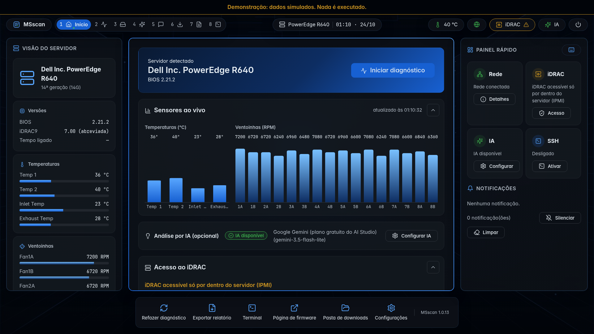

# MSscan

**Diagnóstico de servidores físicos e atualização de firmware Dell, a partir de um pendrive.**

> Projeto corporativo. Código disponível só para consulta; uso e cópia não autorizados ([LICENSE](LICENSE)).

O MSscan é um sistema inicializável (Debian 13) que detecta o que o servidor oferece, diagnostica cada componente sem
tocar nos dados do cliente, mostra onde está cada problema no chassi e, nos servidores Dell, instala as atualizações de
firmware do catálogo oficial com uma única confirmação e retomada automática depois dos reinícios.



> **Aviso.** Atualizar firmware pode inutilizar o servidor se faltar energia ou houver falha de hardware durante a
> gravação. Use nobreak, tenha backup e deixe o servidor fora de operação. O uso é por conta e risco de quem executa.

## Recursos

- **Diagnóstico somente leitura** de fontes, ventoinhas, temperaturas, processadores, memória, discos (SMART), RAID,
  placas de rede e registro de eventos, pela melhor fonte disponível (Redfish → IPMI → sistema operacional).
- **Discos, como o Hard Disk Sentinel:** saúde %, temperatura ao vivo, atributos SMART, autoteste e varredura de
  superfície feitos pelo próprio disco, inclusive atrás da controladora RAID.
- **Mapa por posição:** slot a slot, qual peça funciona e onde está a ruim (ex.: pente não reconhecido no POST).
- **Histórico × atual:** eventos antigos do controlador não são tratados como falhas atuais.
- **Localização física** de cada problema ("DIMM A2 (CPU1)", "Fonte 1"), com mapa e modelo 3D do chassi.
- **Relatórios** em TXT, HTML e JSON no pendrive, e log técnico automático.
- **Análise por IA e conversa** (opcionais), com dados sanitizados antes do envio.
- **Atualização de firmware Dell:** catálogo oficial, SHA-256 conferido, plano com ordem e reinícios, bloqueios por saúde
  do hardware, instalação automática e relatório antes × depois.
- **Ações corretivas** com confirmação: NTP do controlador, limpeza do registro de eventos (depois de exportado), IP fixo do iDRAC.
- Interface gráfica por teclado e mouse (800x600 a 1920x1080); terminal e SSH opcionais, desligados por padrão.

## Cobertura

| | Diagnóstico | Atualização de firmware |
|---|---|---|
| Dell PowerEdge 14ª–16ª geração (iDRAC9) | Completo | Sim (ciclo completo validado no R640) |
| Dell PowerEdge 12ª–13ª geração (iDRAC7/8) | Completo pelo que o iDRAC oferece | Sim (iDRAC validado no R620; demais componentes em validação) |
| Dell 11ª geração (iDRAC6) | Pelo IPMI e sistema operacional | Só pacote manual |
| HPE, Lenovo e outros | Cadeia genérica (Redfish, IPMI, sistema operacional) | Não |

Detalhes em [Compatibilidade](docs/compatibilidade.md).

## Requisitos

- Servidor x86-64, BIOS legado ou UEFI (Secure Boot aceito).
- Pendrive de 2 GB ou mais (8 GB recomendado, para pacotes de firmware e relatórios).
- Rede com DHCP e internet para IA, catálogo e downloads. Sem rede, o diagnóstico local funciona.
- Para atualizar firmware Dell: credenciais de administrador do iDRAC, ou o iDRAC Tools for Linux (baixado sozinho).

## Início rápido

1. Grave a ISO com o **Rufus, modo ISO, esquema MBR, FAT32** (inicia em BIOS e UEFI e guarda os dados no próprio
   pendrive). Outras formas em [Uso](docs/uso.md#gravar-o-pendrive).
2. Ligue o servidor pelo pendrive (F11 no Dell).
3. Informe as credenciais do iDRAC, se houver Redfish (ou pule).
4. O diagnóstico roda sozinho; veja os resultados e a localização física.
5. Opcional: análise por IA; nos Dell, Atualizações → selecionar → plano → digitar `ATUALIZAR`.
6. O relatório fica em `MSSCAN/relatorios/` no pendrive.

Confira a ISO antes de gravar:

```bash
sha256sum -c msscan-<versão>-amd64.iso.sha256
```

## Documentação

| Página | Conteúdo |
|---|---|
| [Uso](docs/uso.md) | Gravação, primeiro uso, pasta de dados, parâmetros de boot, rede, IA, terminal e SSH, relatórios |
| [Diagnóstico](docs/diagnostico.md) | Detecção, fontes por componente, aba Discos, mapa por posição, histórico × atual, localização |
| [Atualização de firmware](docs/atualizacao-de-firmware.md) | Regras, fluxo, bloqueios, caminhos de instalação, retomada |
| [Compatibilidade](docs/compatibilidade.md) | Fabricantes, gerações do iDRAC, o que foi validado e limitações |
| [Segurança](docs/seguranca.md) | Dados do cliente, credenciais, dados enviados, rede |
| [Desenvolvimento](docs/desenvolvimento.md) | Arquitetura, testes, demonstração, build da ISO, coletas |
| [Licenças](docs/licencas.md) | Componentes de terceiros |

Histórico de versões: [CHANGELOG.md](CHANGELOG.md).

## Perguntas frequentes

**Altera os discos do cliente?** Não. Não monta, não lê e não altera partições ou volumes RAID do cliente.

**A senha do iDRAC fica salva?** Não. Fica só na memória durante a execução.

**E se a energia cair durante a atualização?** O estado fica no pendrive; no próximo boot por ele, o MSscan confere o que
foi aplicado e desfaz as mudanças temporárias no iDRAC. Firmware interrompido no meio da gravação depende da recuperação
do próprio fabricante.

## Licença

Copyright (C) 2026 Breno. Todos os direitos reservados.

O código está disponível **apenas para consulta**: pode ser lido para verificar o que o MSscan faz, mas não pode ser
usado, copiado, modificado nem redistribuído sem autorização por escrito. Termos completos em [LICENSE](LICENSE).

Créditos e licenças de terceiros em [docs/licencas.md](docs/licencas.md).
