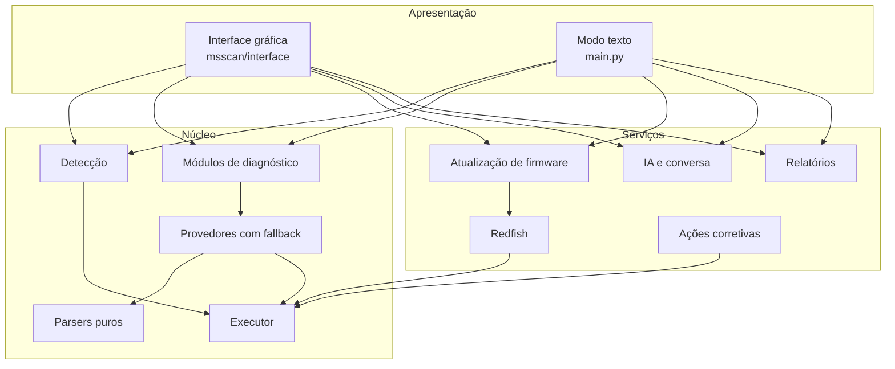

# Desenvolvimento

Python 3.11, só biblioteca padrão e três pacotes da Debian (`requests`, `PyYAML`, `packaging`), empacotado numa ISO
Debian 13. Não há `pip` na ISO.

## Arquitetura



A interface é HTML, CSS e JavaScript puros, servidos por `msscan/interface/servidor.py`, que expõe em JSON as mesmas
funções do núcleo usadas pelo modo texto.

**Executor** (`msscan/core/executor.py`): todo comando, arquivo e requisição HTTP/Redfish passa por ele. Garante tempo
limite, falha sem exceção (vira tentativa registrada), histórico de comandos, listas de permissão para escritas e as
proibições sobre os discos do cliente. Variantes: real, **replay** (saídas gravadas, para testes e demonstração) e
**gravador** (`--coletar`).

| Pacote | Função |
|---|---|
| `msscan/core` | Modelo de resultados, executor, fallback, TLS com o BMC |
| `msscan/rede` | Verificação e monitoramento da rede, relógio, proxy |
| `msscan/deteccao` | Fabricante, modelo, IPMI, Redfish, controladoras, iDRAC Tools → `Contexto` |
| `msscan/provedores`, `msscan/modulos` | Coleta por componente com fallback |
| `msscan/parsers` | Funções puras texto → dados (dmidecode, ipmitool, smartctl, Redfish, catálogo Dell...) |
| `msscan/compat` + `compat_db/` | Banco de compatibilidade por modelo |
| `msscan/redfish` | Cliente Redfish (sessão, reconexão) |
| `msscan/atualizacao` | Inventário, catálogo, verificação, plano, aplicação, retomada, mudanças temporárias |
| `msscan/acoes` | Catálogo fechado de ações corretivas |
| `msscan/ia` | Provedores de IA, sanitização, análise, conversa |
| `msscan/relatorio` | TXT, HTML, JSON, comparação, log técnico |
| `msscan/interface` | Servidor local, sessão, terminal, SSH, pareamento |
| `msscan/navegador` | Navegador integrado e proxy de domínios oficiais |
| `msscan/pendrive`, `msscan/tela` | Local dos dados, escrita segura, resolução de vídeo |
| `msscan/textos/pt_BR.json` | Textos da interface ([guia de escrita](guia_de_escrita.md)) |

Suporte a um modelo ou método novo: um provedor com `disponivel()`/`coletar()` registrado na cadeia do componente
(`msscan/modulos/registro.py`), ou uma entrada em `compat_db/`. O núcleo não muda.

## Rodar localmente

```bash
python3 main.py                                   # modo texto, no próprio servidor (root)
python3 main.py --ui                              # interface em http://127.0.0.1:8765
python3 main.py --ui --replay tests/fixtures/dell/poweredge_r640   # demonstração com dados gravados
python3 main.py --help
```

A demonstração estática (GitHub Pages) fica em `docs/demo/`, gerada por `demo/gerar.py`: dados simulados, nenhuma
chamada de rede.

## Testes

```bash
python3 -m pytest -q
```

Mais de 2.300 testes: parsers contra saídas reais gravadas, diagnóstico de ponta a ponta por replay, mockups Redfish da
DMTF, simuladores (iDRAC falso por HTTPS, `ipmi_sim`, pacotes Dell e racadm falsos) e travas de segurança (nenhuma
combinação de opções chega a uma escrita no iDRAC sem as condições). Cada falha vista em hardware real vira teste.

Formato nunca visto em equipamento real não é presumido: fica marcado `TODO(fixture)` até haver coleta.

## Construir a ISO

Num Debian 13 com `live-build`, ~10 GB livres e internet:

```bash
sudo apt install live-build
sudo ./iso/build.sh
```

Resultado: `iso/msscan-<versão>-amd64.iso` e o `.sha256`. Detalhes em [iso/README.md](../iso/README.md). Cada ISO é
iniciada no QEMU em BIOS e em UEFI com Secure Boot antes da entrega (`iso/testar_qemu.py`).

## Coletas

Para ampliar a cobertura (modelos, controladoras RAID, fabricantes):

1. Inicie o servidor pelo pendrive e use **"Coletar dados deste servidor"** (aba Relatórios) ou `--coletar`: só comandos
   de leitura, saídas brutas num `.tar.gz` em `MSSCAN/coletas/`.
2. Anonimize: `python3 -m msscan.coleta.anonimizar <pasta>` (troca serial, service tag, UUID, MAC, IP, hostname e WWN).
3. Confira o resultado antes de compartilhar.

A coleta vira fixture em `tests/fixtures/<fabricante>/<modelo>/` e entra em `tests/test_coletas_reais.py`. Fixtures nunca
têm dados reais do cliente, chaves, senhas ou arquivos de `vendor/`.

## Versões

A versão está em `msscan/__init__.py` e precisa ser a primeira do [CHANGELOG.md](../CHANGELOG.md) (há teste).
