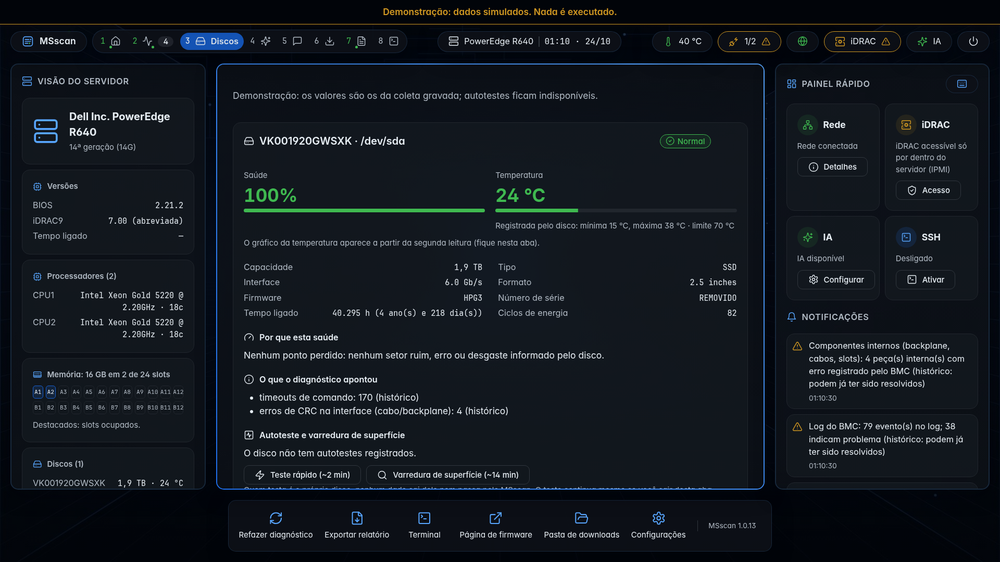

# Diagnóstico

O diagnóstico é **somente leitura**: nenhum comando altera o servidor, o controlador de gerenciamento ou os discos.

## Detecção

Nada é presumido. Antes de diagnosticar, o MSscan descobre o que o servidor oferece:

| Item | Como |
|---|---|
| Fabricante, modelo, System ID, service tag | `dmidecode` (SMBIOS; nos Dell antigos, OEM 208) |
| IPMI | SMBIOS tipo 38, módulos `ipmi_si`/`ipmi_devintf`, `ipmitool mc info` |
| Redfish | SMBIOS tipo 42 ou IP do controlador (`ipmitool lan print`), confirmado por `GET /redfish/v1` |
| Controladoras de armazenamento | `lspci -nnk` e o driver em uso |
| Ferramentas do fabricante | `MSSCAN/vendor/` (perccli, storcli, ssacli, arcconf, racadm...) |

Sem Redfish **não** significa "não suportado": significa diagnóstico parcial pelo IPMI e pelo sistema operacional.

## Fontes por componente

Cada componente tem uma cadeia de fontes, em ordem. Cada tentativa vai para o relatório (*indisponível*, *sem dados*,
*erro*). Se todas falharem, o componente fica **Não verificado**: "não sei" nunca vira "OK".

| Componente | Ordem |
|---|---|
| Sensores (temperatura, tensão) | Redfish → `ipmitool sensor` → lm-sensors |
| Fontes | Redfish → `ipmitool sdr type "Power Supply"` |
| Ventoinhas | Redfish → `ipmitool sdr type Fan` → lm-sensors |
| Processadores | `dmidecode -t 4` + `/proc/cpuinfo` + registro de eventos |
| Memória | `dmidecode -t 17` + EDAC + registro de eventos |
| Registro de eventos | Redfish LogServices → `ipmitool sel elist` |
| Discos | `smartctl` (direto, atrás de MegaRAID/Smart Array/aacraid, NVMe) |
| RAID | Redfish Storage → perccli/storcli → MegaCli → ssacli → arcconf → sensores de baia e bateria do BMC → mdadm |
| Placas de rede | Redfish NetworkAdapters → `ip -s link` + `ethtool` |

Arrays de RAID por software nunca são montados: montar um array degradado poderia escrever nos discos do cliente.

## Aba Discos

Um cartão por disco, como o Hard Disk Sentinel, a partir do mesmo `smartctl -a -j` do diagnóstico (ATA, SAS e NVMe,
inclusive atrás da PERC):

- **Saúde %:** estimativa do MSscan, com uma tabela fixa de penalidades (setores realocados, pendentes e incorrigíveis, erros de mídia,
  SMART reprovado, autoteste reprovado, desgaste) e o motivo de cada ponto perdido, em português. Sem dado suficiente, não há número (nunca 100% por falta de dado).
- **Temperatura ao vivo** (atual, mínima e máxima da vida do disco, limite), relida a cada 30 s só com a aba aberta e
  pausada durante gravação de firmware e diagnóstico.
- Capacidade, interface, horas ligado, ciclos de energia, desgaste e vida restante estimada (SSD/NVMe), atributos e o log
  de autotestes.
- **Autoteste rápido e varredura de superfície** (autoteste estendido): quem lê a superfície é o próprio disco; nenhum
  dado do cliente passa pelo MSscan. Confirmação com foco em "Cancelar" e botão "Interromper".

## Mapa por posição

Todo componente com posições (memória, processadores, fontes, ventoinhas, discos, portas de rede) mostra uma linha por
slot ou peça: OK, Alerta, Falha, Conferir ou Vazio, com o local físico. Na memória, o MSscan cruza o SMBIOS, o Redfish
(com credenciais), o registro de eventos e a ordem de instalação para achar **pente não reconhecido no POST** (aparece no
SMBIOS como slot vazio): "N de M slots com pente reconhecido" e o slot suspeito. Sem evidência, o slot fica Vazio; nada
é inventado.

## Situações

| Situação | Significado |
|---|---|
| Normal | Verificado e sem problema |
| Atenção | Algo a observar (ex.: redundância de energia perdida, evento histórico crítico) |
| Falha | Defeito confirmado por leitura atual |
| Não verificado | Nenhum método confiável disponível; tentativas e motivos listados |
| Não aplicável | O componente não existe neste equipamento |

Fonte com defeito real (Failure detected, Predictive failure) é **Falha**; fonte sem energia ou ausente é **Atenção**.

## Histórico × atual

Todo evento do registro de eventos é **histórico** até uma leitura ao vivo confirmar que o problema continua (EDAC desde
o boot, sensor crítico agora, estado atual pelo Redfish). As datas do controlador não são confiáveis, por isso a data
sozinha não decide nada.

- Evento de peça que não está mais instalada aparece como tal.
- O evento não traz o serial da peça; se a peça foi trocada, o MSscan sugere exportar e limpar o registro de eventos.
- Só evidência **atual e crítica** bloqueia a atualização de firmware.

## Localização física

Cada problema mostra a área física: "DIMM A2 (CPU1)", "Fonte 1 (PSU1, traseira esquerda)", "Ventoinha 3". Sem como
localizar, o MSscan diz isso, sem adivinhar.

- Modelo 3D interativo do chassi (three.js embutido, sem internet) e mapa 2D. Problema atual em vermelho, histórico em
  amarelo, sempre com rótulo.
- Posições exatas no R640 (conferidas no manual). Outros Dell (12ª a 16ª geração, 1U, 2U e torre): modelo do formato
  certo com a indicação "posições aproximadas".

## Configuração do servidor

Processadores, pentes por processador e canal, fontes instaladas × esperadas e discos, comparados com as regras de
montagem do manual oficial (hoje, R640). Dicas por modelo ficam em `compat_db/dell.yaml`: **o banco é dica, a detecção é
a verdade**, e para atualização de firmware o banco só restringe, nunca libera.
