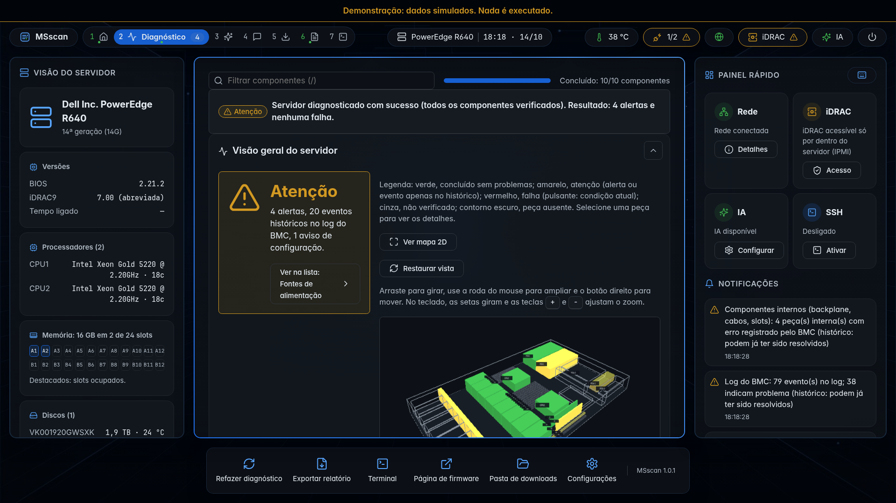
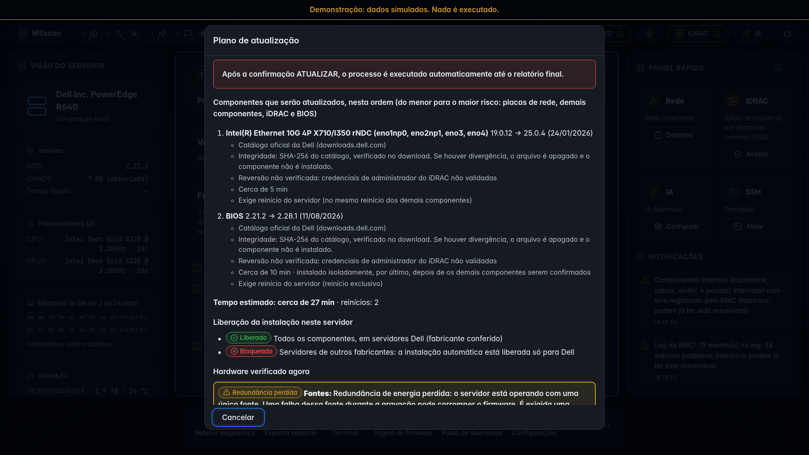

# Uso

## Gravar o pendrive

A ISO é **iso-hybrid** (Debian 13, amd64): inicia em BIOS legado e em UEFI, inclusive com Secure Boot (shim e GRUB
assinados pela Debian).

| Forma | Onde ficam os dados (relatórios, configuração, `vendor/`) |
|---|---|
| **Rufus modo ISO + MBR (recomendado)** | Pasta `MSSCAN/` no próprio pendrive |
| Rufus modo ISO + GPT | Idem, mas só inicia em UEFI |
| Rufus modo DD, `dd`, balenaEtcher | Partição `MSSCAN`, se existir; senão `/tmp` (perdido ao desligar) |
| Ventoy | Pasta `MSSCAN/` na partição de dados do Ventoy |
| Mídia virtual do iDRAC | `/tmp`, com aviso |

O local é escolhido sozinho nessa ordem. **O MSscan nunca formata nem cria partições.** O pendrive fica somente leitura e
só ganha escrita durante cada gravação, com `sync` no fim.

## Primeiro uso

1. Ligue pelo pendrive. A interface gráfica abre em tela cheia; se não abrir em 90 s, o MSscan tenta outro driver de
   vídeo (`fbdev`, `vesa`) e grava os logs no pendrive.
2. O MSscan confere a rede e detecta o servidor.
3. Se houver iDRAC com Redfish, informe usuário e senha (ou **Pular**: o diagnóstico continua pelo IPMI e pelo sistema
   operacional). No máximo 3 tentativas, para não bloquear a conta no iDRAC.
4. O diagnóstico roda sozinho. Use **Refazer diagnóstico** (tudo ou um componente) para comparar antes × depois.
5. Opcional: análise por IA e conversa.
6. Opcional (Dell): aba Atualizações. Ver [Atualização de firmware](atualizacao-de-firmware.md).

Atalhos: `Alt+1` a `Alt+7` trocam de etapa, `?` abre a ajuda, `Esc` volta. Tudo funciona só com teclado.

| Diagnóstico | Plano de atualização |
|---|---|
|  |  |

## Pasta de dados

```
MSSCAN/
├── config/        ia.conf, proxy.conf, ia_provedores.yaml, ssh_authorized_keys
├── vendor/        ferramentas do fabricante (perccli, racadm...) e iDRAC Tools baixado
├── relatorios/    <modelo>_<data>/ (TXT, HTML, JSON) e logs técnicos *_auto.json
├── firmware/      cache do catálogo, pacotes baixados, manual/
├── estado/        atualização pendente e mudanças temporárias no iDRAC
└── acoes/         exportação do registro de eventos, valores anteriores do NTP
```

Nenhuma ferramenta proprietária ou firmware vem na ISO. Ferramentas do fabricante são procuradas em `MSSCAN/vendor/`.

## Parâmetros de boot

| Parâmetro | Efeito |
|---|---|
| `msscan.semrede=1` | Dispensa a rede: diagnóstico local; IA e atualizações desativadas |
| `msscan.resolucao=LxA` | Força a resolução (ex.: `1280x1024`); também pode ser trocada na tela "Sobre" |
| `msscan.terminal=1` | Liga o terminal da interface e os consoles tty2–tty6 |
| `msscan.ssh=1` | Liga o acesso SSH/SFTP |

## Rede

Antes do diagnóstico, o MSscan confere cabo, endereço IP (DHCP pelo NetworkManager) e internet. O relógio do sistema é
acertado antes do HTTPS (NTP, cabeçalho `Date` de dois sites ou hora do iDRAC); o relógio da BIOS nunca é alterado.

Sem internet o MSscan continua (diagnóstico, iDRAC, relatórios, pacotes já no pendrive) e mostra a causa provável: sem
cabo, sem driver, sem DHCP, DNS, proxy ou firewall. A rede é monitorada o tempo todo e o que depende dela retoma sozinho.
Proxy: `MSSCAN/config/proxy.conf`.

## Acesso ao iDRAC

O MSscan alcança o iDRAC de duas formas:

- **Pela rede (Redfish):** iDRAC com cabo e IP alcançável. Para iDRAC antigos, tenta modos de criptografia de
  compatibilidade até um funcionar.
- **Por dentro (racadm local):** o iDRAC Tools for Linux, em `MSSCAN/vendor/` ou baixado do site da Dell (SHA-256
  conferido), preparado na memória, nunca nos discos do cliente.

Se nenhuma funcionar, a caixa "Acesso ao iDRAC" lê a configuração de rede pelo IPMI e diz o que fazer (ligar o cabo na
porta dedicada, conferir o DHCP, IP em outra rede...). O MSscan nunca reconfigura a rede do iDRAC sozinho.

## Análise por IA e conversa

Opcional (padrão: não). A IA interpreta o diagnóstico, nunca o substitui, e não executa comandos.

- Provedores gratuitos: Google Gemini, Groq, OpenRouter, Mistral. Pagos: Claude, ChatGPT, Gemini, DeepSeek, OpenRouter.
- IA principal + reserva: limite, erro ou tempo esgotado na principal → reserva sozinha.
- Chave: tela "Configurar IA" (com botão "Testar"), pelo celular (QR Code, porta aberta por até 5 min) ou em
  `MSSCAN/config/ia.conf`.
- Antes de enviar, são removidos serial, service tag, UUID, asset tag, MAC, IP, hostname e WWN; há prévia do que vai.
- Cada evidência citada pela IA é conferida contra os dados reais.

## Terminal, SSH e energia

- **Terminal** (aba Terminal): shell de administrador, só local, nunca pela rede nem para a IA. Desligado por padrão.
- **SSH/SFTP:** usuário `tecnico` com senha aleatória gerada na hora (ou chaves em `MSSCAN/config/ssh_authorized_keys`),
  porta 22 só para a rede local e só enquanto ativo. Desligado por padrão.
- **Desligar/Reiniciar:** com `sync` e desmontagem do pendrive; bloqueados durante gravação de firmware.

## Relatórios

Gravados em `MSSCAN/relatorios/<modelo>_<data>/`:

| Formato | Uso |
|---|---|
| TXT | Leitura rápida |
| HTML autocontido | Enviar ao cliente ou anexar ao chamado; abre sem internet |
| JSON | Integração; todos os dados, tentativas e comandos |

O relatório traz o veredito ("diagnosticado com sucesso" ou "parcialmente diagnosticado"), a fonte de cada informação,
a interpretação da IA (se usada), as atualizações com antes × depois e as ações corretivas. O **log técnico**
(`*_auto.json`) é gravado sozinho a cada etapa; é o arquivo a enviar quando algo falha. Senhas, chaves e tokens nunca
entram.

## Ações corretivas

Catálogo fechado, cada uma com verificação prévia, tela do que será alterado e confirmação digitada `CORRIGIR`:

| Ação | Proteção |
|---|---|
| Limpar o registro de eventos | Só depois de exportado para `MSSCAN/acoes/` e conferido (SHA-256 e quantidade de eventos) |
| NTP do controlador | Valores anteriores gravados; botão "Desfazer" |
| IP fixo do iDRAC | Testa antes se o IP está livre; nunca automática |
| Limpar tarefa travada na fila do iDRAC | Nunca com firmware sendo gravado |
